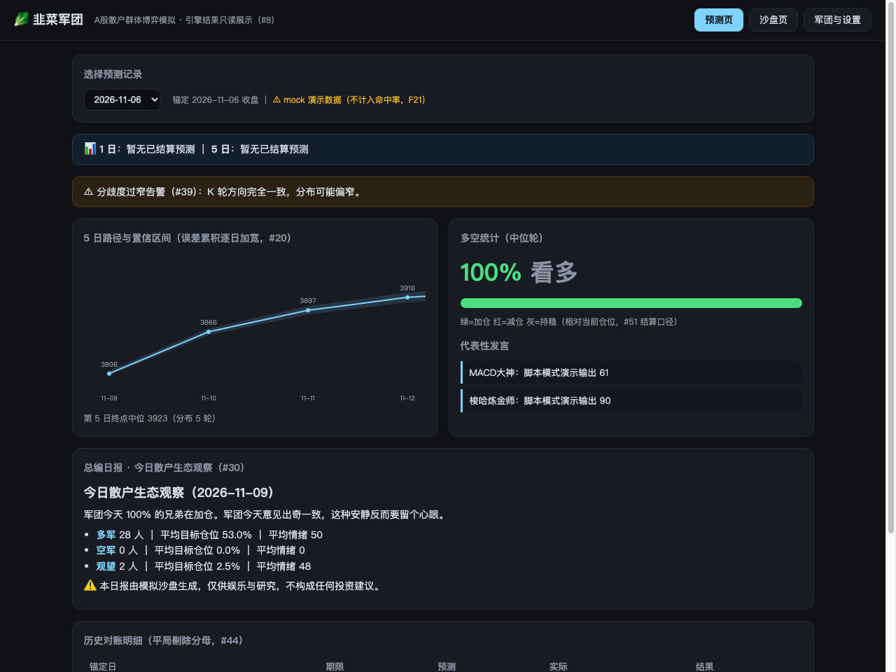
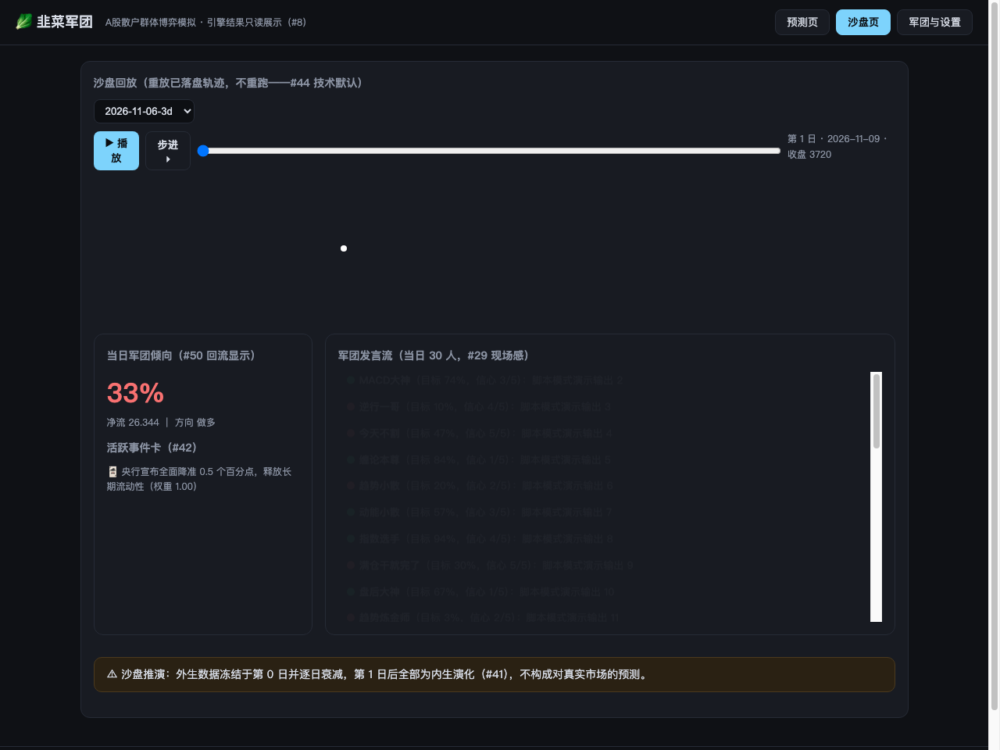
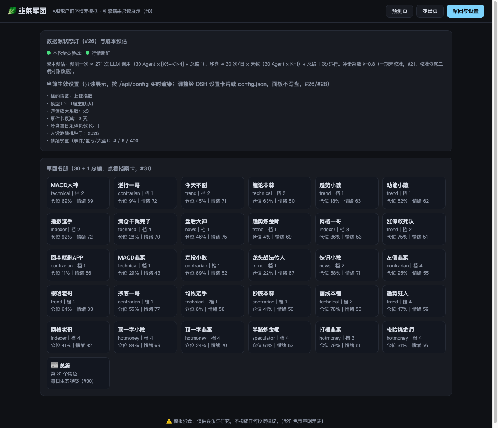

# 韭菜军团 `dsh-jiucai-legion`

[](LICENSE) [](https://github.com/zo0043/dsh-jiucai-legion) [](https://github.com/deepseek-ai/deepseek-harness) [](https://github.com/zo0043/dsh-jiucai-legion/actions)

> 🥬 A 股散户群体博弈模拟沙盘 —— DeepSeek Harness (DSH) 官方插件
> 30 个 Agent（25 散户 + 5 游资）每日博弈，输出上证指数**次日 / 5 日**涨跌分布 + 《今日散户生态观察》日报

**⚠️ 模拟沙盘，仅供娱乐与研究，不构成任何投资建议。**（本声明常驻于产品所有输出与面板页脚）

| 预测页（安静日报） | 沙盘页（现场感） | 军团档案卡 |
|---|---|---|
|  |  |  |

---

## 这是什么

韭菜军团把 A 股散户群体做成一个可观察、可对账的模拟沙盘：

- **预测页（安静日报）**：盘后 1 分钟看结论——次日收盘估计、5 日逐日路径（置信区间逐日加宽）、多空统计、代表性发言、滚动命中率（「最近 20 次命中 12 次」，平局剔除分母）。
- **沙盘页（现场感）**：what-if 一句话展开成事件卡定向注入；逐日回放推进、阵营变色、发言流滚动。外生数据冻结于第 0 日并逐日衰减——沙盘是纯内生演化，不是对真实市场的预测。
- **军团名册（档案卡）**：30+1 个角色各有主页——人设、持仓、情绪、操作复盘、性格漂移曲线（目标仓位/置信度滚动序列）。

Agent 心理设定：三维人设（资金规模 × 风格 × 情绪稳定性）+ 立场先验 + 散户行为偏差（损失厌恶/回本执念/追涨/锚定成本）+ 游资纪律条款（止损铁律）；标量情绪引擎（0–100，事件卡/个人盈亏/大盘波动三源驱动，衰减回基线）；记忆上限 20 条，盈亏统计自动注入（「近 10 次判断错了 7 次」）让 LLM 自己演出动摇。

## 安装

### 作为 DSH 插件（推荐）

要求：DSH 宿主（DSH 本身要求 Node ≥ 24.9）、Python ≥ 3.10。

```sh
# 1. 克隆本仓库
git clone https://github.com/zo0043/dsh-jiucai-legion.git && cd dsh-jiucai-legion
# 2. 安装 Node 依赖
npm install && npm run build
# 3. 建 Python 数据环境（akshare + baostock）
python3 -m venv .venv && .venv/bin/pip install -r python/requirements.txt
# 4. 装进 DSH（已实测：DSH 0.2.2-rc.1 + Node ≥24.9）
corepack enable                                    # 启用 pnpm（DSH plugin 命令依赖它）
dsh plugin --profile <你的profile> add /path/to/dsh-jiucai-legion
#    若报 ERR_PNPM_ADDING_TO_ROOT：echo "ignore-workspace-root-check=true" >> $DSH_HOME/profiles/<profile>/.npmrc 后重试
# 5. 在 DSH（web/tui/headless）里使用：/jiucai-init → /jiucai-predict → /jiucai-report 等 8 个命令
```

⚠ **兼容性说明**：本插件按 DSH 0.2.2-rc.1 的真实 cordis 契约实现（bundle = `dsh.bundle.patch` 指向 `cordis.patch.yml`；插件函数带 `inject: ['llm','subprocess','commands']`；命令经 `ctx.commands.register`）。DSH developer preview 变化频繁——若命令面失效，引擎与日报仍可通过独立 CLI 使用（见下）。环境变量：`DJIUCAI_PYTHON`（.venv 的 python 绝对路径）、`DJIUCAI_DATA_DIR`、`DJIUCAI_DSH_MODEL`（默认 deepseek-chat）。

### 独立 CLI（不需要 DSH）

```sh
npm run cli -- init                       # 冷启动：组建军团（人设池预览）
npm run cli -- predict                    # 首跑预测（拉 250 日数据 + 首预测，约 270 次 LLM 调用）
npm run cli -- report                     # 最近一期日报
npm run cli -- sandbox --days 20 --event "央行宣布全面降准 0.5 个百分点"
npm run cli -- panel                      # 打开本地面板 http://127.0.0.1:3210
npm run cli -- reconcile                  # 历史预测对账 + 滚动命中率
npm run cli -- reset                      # 一键重置军团状态
```

### DSH 原生客户端面板（client bundle，双路径）

DSH web 里除命令面外还有一条**原生面板路径**：`src/panel/`（TSX）经 esbuild 打包为 `dist/client.js`，由 DSH 的 client-modules 系统装载——侧栏出现「韭菜军团」入口（`sidebar.panellist` 槽位），点击在中心列挂载三视图主面板（`main` 槽位，key=`jiucai-legion`）。**面板数据一律走绝对 URL `http://127.0.0.1:3210/api/…`**（迁入 DSH origin 后相对路径会打到 DSH 服务器全 404；panel-server 已带 CORS 头，简单 GET 不触发预检）。

| 路径 | 入口 | 说明 |
|------|------|------|
| DSH 原生面板 | DSH web 侧栏「韭菜军团」 | 本轮新增；随 DSH 常驻，热更见下 |
| 独立面板页（Plan B 回退） | `npm run cli -- panel` → `http://127.0.0.1:3210` | `static/panel.html` 原样保留，与原生面板同一 API 契约 |

构建与装载约束（改 `src/panel/**` 前必读）：

- **external = 官方种子词快照**：`scripts/build-client.mjs` 的 external 表逐词对应 `dsh-web-frontend` 当前 minified 产物里的 `YZ()` 种子表（react、react/jsx-runtime、react-dom、react-dom/client、@deepseek-ai/cordis、zod、@tanstack/react-virtual、dsh-client-store/ui-slots/ui-primitives/ui-dockkit，2026-11-07 快照共 11 项）。**DSH 升级可能增减种子词**：若产物 require 了非种子词，运行时报 `require("…") missed the module table … build-time externals drift`（报错会点名 specifier），按报错在 `scripts/build-client.mjs` external 表与 `package.json` 的 `dsh.client` 声明**两处同步**补充。
- **exports 深导入限制**：`package.json` 的 exports 三键（`.` / `./package.json` / `./client`）生效后，未列出的子路径导入会 `ERR_PACKAGE_PATH_NOT_EXPORTED`。已确认本仓库 `cordis.patch.yml` 与 DSH profile patch 均无深导入，风险低；新增深导入需同步加 exports 键。
- **重启耦合**：`package.json`（exports + `dsh.client`）与 `dist/client.js` 必须同批落地后再重启 DSH——manifest 先落而产物缺失时 `readClientBundle` 抛 `MissingClientBundleError` → `ClientPackageCompositionError` → clientModules fiber FAILED → `/plugins` 路由与 `webserver/index-inject` 全部消失（官方 UI 一起不可用）。重启前置检查：`test -f dist/client.js`。
- **热更（HMR）**：`dsh-client-hmr` 默认 500ms stat 轮询每行 bundle（mtime/ctime/size 三元组）→ `rebuilt` → SSE 通知页面重发模块，**重建 `dist/client.js` 后约 0.5–1s 浏览器内生效，无需重启**；`touch dist/client.js` 也会触发（rev 即三元组 hash），属预期。
- **已知问题（记录，待后续修）**：插件经插件管理器停用再复用时，panel-server 句柄不随插件卸载关闭（`src/host/dsh-adapter.ts` 的 `startPanel` 无 dispose），第二次实例化按端口占用递增到 :3211 并在日志可见；重启 DSH 恢复单实例 :3210。客户端面板写死 :3210，复用旧句柄仍可用，但多实例期间独立页可能与面板读到不同实例。
- **后续迭代候选（不进本期）**：设置页挂入口（`settings.section` 槽位，官方样例 `dsh-client-ui-settings-plugins` client.js:255-266）；`dsh.client.immediately: true`（仅启动期 prefetch，best-effort，暂不用）；宿主桥数据通道（client 半经 `ctx.remote`/action 拉取宿主数据）需专项勘察协议后排期。

LLM 接入：DSH 内自动走宿主模型；独立 CLI 读 `OPENAI_API_KEY`（OpenAI 兼容接口，默认 DeepSeek），或 `--mock` 用脚本模式演示数据流（零成本）。

## 出网行为（必须写明，#28）

| 组件 | 出网目标 | 用途 | 可否关闭 |
|------|----------|------|----------|
| Python 数据子进程 | 东方财富 / 新浪财经 / 雪球 / 财联社 / baostock（上证链） | 日线、日历、涨停池、情绪榜、新闻、两融、北向盘后 | 否（核心功能） |
| 独立 CLI LLM | `OPENAI_BASE_URL`（默认 api.deepseek.com） | Agent 推理 | 是（DSH 内走宿主模型；`--mock` 完全不出网） |
| 其他 | 无遥测、无上报、无自动更新检查 | — | — |

数据缓存于本地 `data/` 目录；上游接口失效时自动降级到缓存并显著标注数据截至日。**绝不使用盘中北向估算数据**（北向自 2024-05 起仅盘后披露）。

## 配置（全默认值零手调）

| 设置项 | 默认 | 说明 |
|--------|------|------|
| 标的指数 | 上证指数 | 可切沪深 300（情绪/宽度为全市场口径，资金面取最贴近口径） |
| 游资放大系数 | 3× | 净流聚合中游资权重倍数（数值可调 1–10） |
| 事件卡衰减 | 2 天 | what-if 事件影响线性衰减天数 |
| 沙盘 K | 1 | 每日采样轮数（高级选项，沙盘成本 = 30×K×天数） |
| 情绪引擎权重 | 4 / 6 / 400 | 事件卡/个人盈亏/大盘波动三源系数（#48，技术设计 §5.2） |
| 冲击系数 | 0.8（未校准） | 一期默认，面板明示；校准依赖二期对账数据 |
| 随机种子 | 2026 | 人设池确定性生成 |

设置经 DSH 设置卡片（同构 schema 见 `src/config.ts` SETTING_FIELDS，含上述全部项）或 `config.json` 修改；Web 面板只读展示当前生效值与按配置实算的成本预估。

## 对账口径

方向 = K 轮净流**中位数符号**；实际涨跌 |x| < 0.1% 记**平局**、从命中率分母剔除并在面板标注。1 日与 5 日分开统计。

## 架构与文档

- [需求文档](./韭菜军团需求文档.md) —— 三轮 grill 定稿的 52 项设计决策
- [技术设计](./docs/技术设计.md) —— 模块拆解、领域类型、数据源映射、测试策略
- 引擎核（`src/engine/**`）不依赖 DSH，可独立测试；宿主能力经端口注入（`src/host/ports.ts`）

## License

MIT（见 [LICENSE](./LICENSE)）
